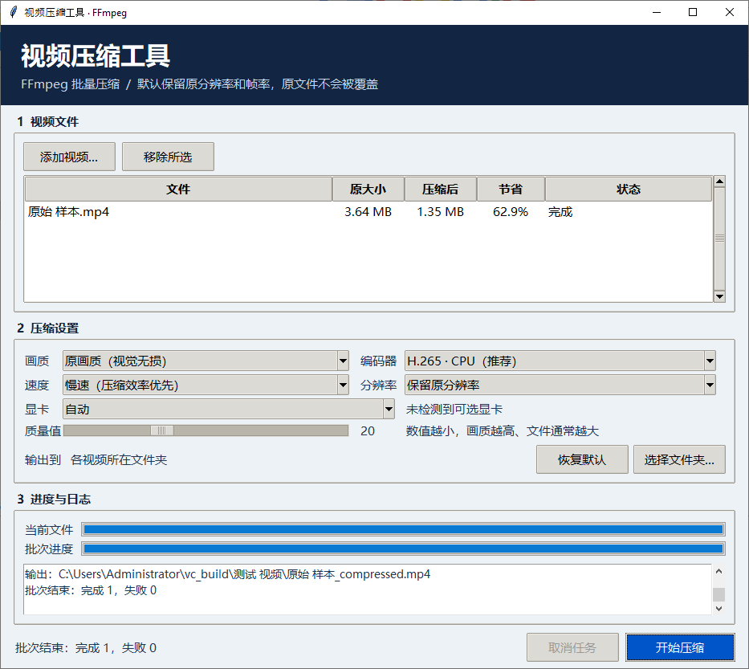

# FFmpeg 视频压缩工具

面向 Windows 的中文视频压缩工具，支持批量输出 MP4，也可以在双显卡电脑上指定显卡。默认用 CPU 的 H.265 慢速编码，保留原分辨率和帧率，适合画质优先的场景。

## 下载

前往 [最新 Windows 发行版](https://github.com/baicai2026-baicai/video-compressor/releases/latest)，下载 Windows ZIP，解压整个文件夹，双击其中的 `视频压缩工具.exe` 即可。无需安装 Python；请将压缩包内的 FFmpeg 工具与程序保留在同一文件夹。

## 主要功能

- 多选视频批量压缩，可指定输出文件夹。默认在各原文件所在位置生成 `原文件名_compressed.mp4`；遇到同名文件会自动编号，不覆盖文件。
- 画质档位：原画质（视觉无损）、高画质、均衡、体积优先，对应 H.265 CPU 的 CRF 20、23、26、28；也可以用滑块自定义。数值越小，画质通常越高，文件也通常越大。
- 支持 H.265 / H.264 CPU 编码，以及 NVIDIA NVENC、Intel Quick Sync、AMD AMF 硬件编码。可保留原分辨率或限制到 1080p / 720p。
- 显示当前文件及批次进度、日志、输出大小和节省比例；可取消，已完成的文件会保留。
- 保留主视频、音轨、可转换的文本字幕和兼容元数据。AAC 等兼容音轨直接复制，其他音轨转为 AAC。

**“视觉无损”不等于数学无损。** 建议先用一段代表性素材试压，再比对细节和文件体积。压缩后不保证一定更小；工具发现体积增大时会提示，不会删除原文件。

## 从源码运行

1. 从 [Gyan.dev FFmpeg builds](https://www.gyan.dev/ffmpeg/builds/) 下载较新的 **release full build**（`ffmpeg-release-full.7z`）。
2. 解压，从 `bin` 复制 `ffmpeg.exe` 和 `ffprobe.exe`，将它们放到 `video_compressor.py` 或 `video_compressor.exe` 同一目录，也可将 FFmpeg 的 `bin` 目录加入 PATH。
3. 运行源码需要 Python 3.10 或更高版本（安装时保留 Tcl/Tk）。在项目目录运行：

   ```bat
   python video_compressor.py
   ```

4. 点击「添加视频」，选择画质和编码器，再点击「开始压缩」。播放设备不支持 H.265 时，可以用 H.264。

## 双显卡怎么选？

从「显卡」下拉框选择检测到的具体显卡，软件会按品牌切换到相应的硬件编码器，并检测是否能启动。保留「自动」时，硬件编码器会按 FFmpeg 的默认规则选设备；使用 CPU 编码时不使用显卡编码。

有显卡不代表它支持所选编码格式。若某块显卡的 H.265 显示「不可用」，试试该卡的 H.264，或改用另一块显卡／CPU。也请确认显卡驱动已安装；NVIDIA 显卡的检测需要驱动附带的 `nvidia-smi.exe`。硬件编码通常更快，但不保证同画质下比 CPU 编码更小。

## 在 Windows 打包 EXE

双击 `build_exe.bat`，或在项目目录执行：

```bat
python -m pip install pyinstaller
python -m PyInstaller -F -w video_compressor.py
```

EXE 在 `dist\video_compressor.exe`。FFmpeg 工具不打进程序 EXE，运行时仍需把 `ffmpeg.exe` 和 `ffprobe.exe` 放入同一目录，或配置 PATH。

## 测试与截图

本地运行 `python -m unittest -v`。实际编码测试需要 PATH 中有近期版本的 FFmpeg（须支持 `-fps_mode`）和 ffprobe。



许可证：[MIT](LICENSE)。
